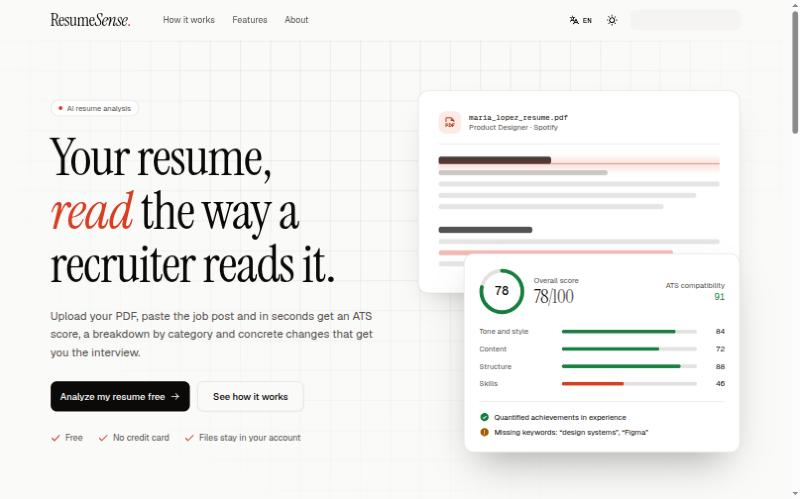

<div align="center">


# ResumeSense

**Análisis de CV con IA que lee tu currículum como lo hace un reclutador.**

[](https://reactrouter.com)
[](https://www.typescriptlang.org)
[](https://tailwindcss.com)
[](https://nodejs.org)
[](https://github.com/ingfranciscastillo/ai-resume-analyzer/commits/main)
[](LICENSE)

[English](README.md) · **Español**

[Características](#características) · [Primeros pasos](#primeros-pasos) · [Cómo funciona](#cómo-funciona) · [Configuración](#configuración) · [Despliegue](#despliegue)



</div>

Sube tu CV en PDF, indica el puesto al que aplicas y ResumeSense te devuelve una puntuación ATS, una nota por categoría y cambios concretos y explicados. Todo funciona con [Puter.js](https://docs.puter.com): no hay backend que mantener y tus archivos quedan en tu propia cuenta de Puter.

## Características

- **Puntuación ATS**: comprueba si tu CV supera los filtros automáticos de las empresas.
- **Ajuste a la oferta**: compara tu CV con la descripción del puesto y señala las palabras clave que faltan.
- **Cuatro categorías**: tono y estilo, contenido, estructura y habilidades, cada una con su nota y sus consejos.
- **Consejos accionables**: cada recomendación explica qué cambiar y por qué importa.
- **Panel**: cada análisis se guarda con su puntuación para comparar versiones.
- **Español e inglés**: detecta el idioma del navegador y recuerda tu elección; la IA responde en el idioma elegido.
- **Modo claro y oscuro**: sigue al sistema, con selector manual.
- **Privado**: los CV y resultados viven en la cuenta de Puter del usuario y se pueden borrar desde `/wipe`.

## Primeros pasos

### Requisitos

- [Node.js](https://nodejs.org) 22.22 o superior (incluye un `.nvmrc`)
- [pnpm](https://pnpm.io) 12, activado con Corepack (`corepack enable pnpm`)
- Una cuenta gratuita de [Puter](https://puter.com) para iniciar sesión en la app

### Ejecutar en local

```bash
git clone https://github.com/ingfranciscastillo/ai-resume-analyzer.git
cd ai-resume-analyzer
nvm use
corepack enable pnpm
pnpm install
pnpm dev
```

Abre http://localhost:5173 e inicia sesión con Puter para analizar un CV.

> [!NOTE]
> No hace falta configurar claves de API. La IA, el almacenamiento de archivos, el almacén clave-valor y la autenticación los proporciona Puter.js en el navegador, con la cuenta del usuario que inició sesión.

### Scripts

| Comando | Descripción |
| --- | --- |
| `pnpm dev` | Inicia el servidor de desarrollo con HMR |
| `pnpm typecheck` | Genera los tipos de las rutas y ejecuta TypeScript |
| `pnpm build` | Compila para producción |
| `pnpm start` | Sirve la build de producción |

## Cómo funciona

1. El PDF se sube al almacenamiento de Puter del usuario.
2. [pdf.js](https://mozilla.github.io/pdf.js/) convierte la primera página en una imagen para la vista previa.
3. El CV y los datos del puesto se envían a Claude mediante `puter.ai.chat`, con un prompt que pide un informe en JSON en el idioma del usuario.
4. El informe se guarda en el almacén clave-valor de Puter y se muestra en `/resume/:id`.

### Rutas

| Ruta | Descripción |
| --- | --- |
| `/` | Landing pública |
| `/auth` | Inicio de sesión con Puter |
| `/dashboard` | Lista de tus análisis |
| `/upload` | Nuevo análisis |
| `/resume/:id` | Informe del análisis |
| `/about` | Acerca del proyecto |
| `/wipe` | Borrar todos tus datos guardados |

### Stack

- [React Router 8](https://reactrouter.com) en modo framework con SSR, sobre React 19 y Vite 8
- [Tailwind CSS 4](https://tailwindcss.com) con componentes de [shadcn/ui](https://ui.shadcn.com)
- [Phosphor Icons](https://phosphoricons.com) y las fuentes Instrument Serif y Geist
- [Puter.js](https://docs.puter.com) para la IA, el almacenamiento y la autenticación
- Un diccionario tipado para i18n en `app/lib/i18n`; el idioma se resuelve en el servidor a partir de una cookie o de `Accept-Language`

## Configuración

El modelo de IA se define en `AI_MODEL`, en [`app/lib/puter.ts`](app/lib/puter.ts).

> [!WARNING]
> Puter retira modelos antiguos. Si un análisis falla con `Model not found`, inicia sesión, ejecuta `await puter.ai.listModels()` en la consola del navegador y cambia `AI_MODEL` por uno de los ids de la lista.

Las traducciones están en [`app/lib/i18n/dictionaries.ts`](app/lib/i18n/dictionaries.ts). Los dos idiomas comparten un mismo tipo, así que si falta una clave TypeScript da error.

## Despliegue

La app se compila como un servidor Node estándar, así que funciona en cualquier hosting con Node 22.

```bash
docker build -t resumesense .
docker run -p 3000:3000 resumesense
```

> [!TIP]
> En Vercel o plataformas similares, configura Node.js 22 o superior en los ajustes del proyecto; React Router 8 no compila con versiones anteriores.

## Autor

Hecho por [Francis Castillo](https://github.com/ingfranciscastillo).
