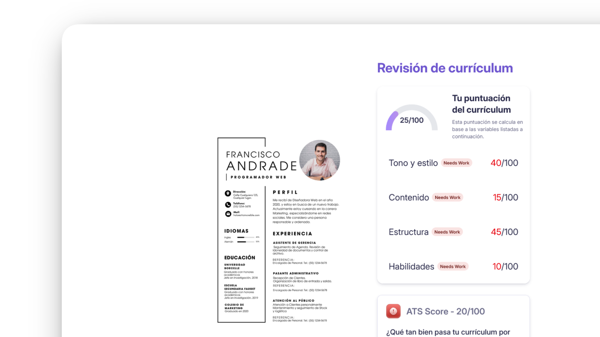

# AI Resume Analyzer

[](https://resumesense.vercel.app/)
[](https://www.behance.net/ingfranciscastillo)
[](https://github.com/ingfranciscastillo/ai-resume-analyzer/stargazers)
[](LICENSE)
[](https://linkedin.com/in/ingfranciscastillo)
[](https://github.com/ingfranciscastillo/ai-resume-analyzer/commits/main)



Una aplicación moderna y potente que utiliza inteligencia artificial para analizar, evaluar y mejorar currículos vitae. Obtén retroalimentación instantánea sobre tu CV con puntuaciones detalladas, áreas de mejora y recomendaciones personalizadas.

## ✨ Características

- **Puntuación ATS** - Comprueba si tu CV supera los filtros automáticos de las empresas
- **Ajuste a la oferta** - Compara tu CV con la descripción del puesto y detecta palabras clave que faltan
- **Cuatro categorías** - Tono y estilo, contenido, estructura y habilidades, cada una con su nota y consejos
- **Consejos accionables** - Cada recomendación explica qué cambiar y por qué
- **Historial** - Panel con todos tus análisis y su puntuación
- **Español e inglés** - Detecta el idioma del navegador; la IA responde en el idioma elegido
- **Modo claro y oscuro** - Sigue al sistema, con selector manual
- **Privado** - Tus archivos y resultados viven en tu cuenta de Puter; puedes borrarlos desde `/wipe`

## 🛠️ Stack Tecnológico

- **Frontend**: React 19 + React Router v8 (SSR)
- **Estilos**: Tailwind CSS v4 + componentes shadcn/ui
- **Tipografía**: Instrument Serif + Geist / Geist Mono
- **Iconos**: Phosphor Icons
- **i18n**: diccionarios propios (`app/lib/i18n`), idioma por cookie o `Accept-Language`
- **IA, almacenamiento y autenticación**: Puter.js (modelo configurable en `AI_MODEL`, `app/lib/puter.ts`)
- **PDF**: pdf.js para generar la vista previa
- **Bundling**: Vite 8
- **Tipado**: TypeScript
- **Contenerización**: Docker (Node 22)

## 🚀 Inicio Rápido

### Requisitos Previos

- Node.js 22.22+ instalado (hay un `.nvmrc`: ejecuta `nvm use`)
- npm o pnpm
- Git

### Instalación

1. Clona el repositorio:

```bash
git clone https://github.com/ingfranciscastillo/ai-resume-analyzer.git
cd ai-resume-analyzer
```

2. Instala las dependencias:

```bash
npm install
```

3. Inicia el servidor de desarrollo:

```bash
npm run dev
```

La aplicación estará disponible en `http://localhost:5173`

## 📦 Comandos Disponibles

```bash
# Desarrollo con HMR
npm run dev

# Generar tipos de rutas y comprobar TypeScript
npm run typecheck

# Construir para producción
npm run build

# Servir la build de producción
npm run start
```

## 🐳 Despliegue con Docker

```bash
# Construir la imagen
docker build -t ai-resume-analyzer .

# Ejecutar el contenedor
docker run -p 3000:3000 ai-resume-analyzer
```

## 📁 Estructura del Proyecto

```
ai-resume-analyzer/
├── app/
│   ├── components/       # Componentes React (layout, landing, feedback, ui)
│   ├── routes/          # Rutas: landing, dashboard, auth, upload, resume, about, wipe
│   ├── lib/             # Puter.js, i18n, PDF y utilidades
│   ├── root.tsx         # Componente raíz
│   └── app.css          # Estilos globales
├── build/                # Output de producción
├── public/               # Recursos públicos
├── types/                # Definiciones de tipos TypeScript
├── constants/            # Constantes de la aplicación
├── components.json       # Configuración de shadcn/ui
├── package.json
├── tsconfig.json
├── vite.config.ts
└── react-router.config.ts
```

## 💡 Cómo Usar

1. **Autenticación** - Inicia sesión con tu cuenta de Puter.
2. **Carga tu CV** - Indica la empresa, el puesto y la oferta, y sube tu CV en PDF.
3. **Análisis Automático** - Puter.js analiza tu CV en segundos
4. **Revisa tu Puntuación** - Observa tu calificación general y detallada
5. **Lee Recomendaciones** - Obtén sugerencias específicas de mejora
6. **Panel** - Consulta todos tus análisis en `/dashboard`

## 📊 Ejemplo de Análisis

El analizador evalúa:

- Estructura y formato del documento
- Claridad y concisión del contenido
- Presencia de habilidades clave
- Logros y métricas cuantificables
- Palabras clave del sector
- Puntuación de ATS (Applicant Tracking System)

## 📝 Licencia

Este proyecto está bajo la licencia MIT. Ver el archivo `LICENSE` para más detalles.

## ❓ Troubleshooting

### Error: "Port already in use"

Si el puerto 5173 está en uso, puedes especificar otro puerto:

```bash
npm run dev -- --port 3000
```

### Error de compilación en Docker

Asegúrate de tener la versión más reciente de Node.js (18+) y limpia el cache:

```bash
npm run build
docker build -t ai-resume-analyzer .
```

### Problemas con Puter.js

Verifica tu conexión a internet. Puter.js requiere acceso a sus servidores para autenticación y análisis de CVs.

### El análisis falla con "Model not found"

Puter retira modelos antiguos. Abre la consola del navegador con sesión iniciada, ejecuta `await puter.ai.listModels()` y cambia `AI_MODEL` en `app/lib/puter.ts` por uno de la lista.

## 👨‍💻 Autor

**Francis Castillo**

- GitHub: [@ingfranciscastillo](https://github.com/ingfranciscastillo)

## 🔗 Enlaces Útiles

- [Documentación Puter.js](https://docs.puter.com/)
- [Documentación React Router](https://reactrouter.com/)
- [Documentación TailwindCSS](https://tailwindcss.com/)
- [TypeScript Handbook](https://www.typescriptlang.org/docs/)
