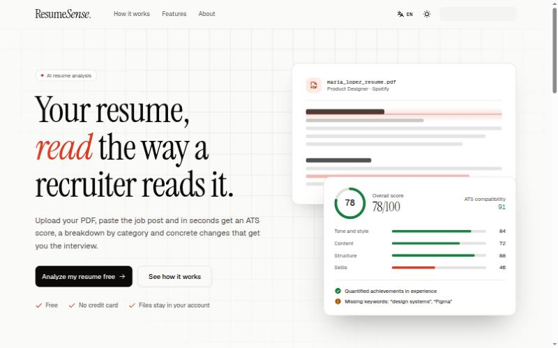

<div align="center">


# ResumeSense

**AI resume analysis that reads your CV the way a recruiter does.**

[](https://reactrouter.com)
[](https://www.typescriptlang.org)
[](https://tailwindcss.com)
[](https://nodejs.org)
[](https://github.com/ingfranciscastillo/ai-resume-analyzer/commits/main)

**English** · [Español](README.es.md)

[Features](#features) · [Getting started](#getting-started) · [How it works](#how-it-works) · [Configuration](#configuration) · [Deployment](#deployment)



</div>

Upload your resume as a PDF, add the job you're applying for, and ResumeSense returns an ATS score, a grade for each category and concrete, explained changes to make. Everything runs on [Puter.js](https://docs.puter.com), so there's no backend to host and your files stay in your own Puter account.

## Features

- **ATS score**: checks whether your resume gets past the automated filters companies use.
- **Job match**: compares your resume with the job description and flags missing keywords.
- **Four categories**: tone and style, content, structure and skills, each with its own score and tips.
- **Actionable advice**: every tip explains what to change and why it matters.
- **Dashboard**: every analysis is saved with its score so you can compare versions.
- **English and Spanish**: picks the browser language and remembers your choice; the AI answers in the selected language.
- **Light and dark mode**: follows the system, with a manual switch.
- **Private**: resumes and results live in the user's Puter account and can be deleted from `/wipe`.

## Getting started

### Prerequisites

- [Node.js](https://nodejs.org) 22.22 or later (an `.nvmrc` is included)
- A free [Puter](https://puter.com) account to sign in to the app

### Run locally

```bash
git clone https://github.com/ingfranciscastillo/ai-resume-analyzer.git
cd ai-resume-analyzer
nvm use
npm install
npm run dev
```

Open http://localhost:5173 and sign in with Puter to analyze a resume.

> [!NOTE]
> There are no API keys to set up. AI, file storage, the key-value store and authentication are provided by Puter.js in the browser, under the signed-in user's account.

### Scripts

| Command | Description |
| --- | --- |
| `npm run dev` | Start the dev server with HMR |
| `npm run typecheck` | Generate route types and run TypeScript |
| `npm run build` | Build for production |
| `npm run start` | Serve the production build |

## How it works

1. The PDF is uploaded to the user's Puter storage.
2. [pdf.js](https://mozilla.github.io/pdf.js/) renders the first page to an image for the preview.
3. The resume and the job details are sent to Claude through `puter.ai.chat`, with a prompt that asks for a JSON report in the user's language.
4. The report is stored in Puter's key-value store and shown on `/resume/:id`.

### Routes

| Route | Description |
| --- | --- |
| `/` | Public landing page |
| `/auth` | Sign in with Puter |
| `/dashboard` | List of your analyses |
| `/upload` | New analysis |
| `/resume/:id` | Analysis report |
| `/about` | About the project |
| `/wipe` | Delete all your stored data |

### Tech stack

- [React Router 8](https://reactrouter.com) in framework mode with SSR, on React 19 and Vite 8
- [Tailwind CSS 4](https://tailwindcss.com) with [shadcn/ui](https://ui.shadcn.com) components
- [Phosphor Icons](https://phosphoricons.com), Instrument Serif and Geist fonts
- [Puter.js](https://docs.puter.com) for AI, storage and authentication
- A small typed dictionary for i18n in `app/lib/i18n`, with the language resolved on the server from a cookie or `Accept-Language`

## Configuration

The AI model is set in `AI_MODEL` in [`app/lib/puter.ts`](app/lib/puter.ts).

> [!WARNING]
> Puter retires old models. If an analysis fails with `Model not found`, sign in, run `await puter.ai.listModels()` in the browser console and set `AI_MODEL` to one of the listed ids.

Translations live in [`app/lib/i18n/dictionaries.ts`](app/lib/i18n/dictionaries.ts). Both languages share one type, so a missing key is a type error.

## Deployment

The app builds to a standard Node server, so it runs on any Node 22 host.

```bash
docker build -t resumesense .
docker run -p 3000:3000 resumesense
```

> [!TIP]
> On Vercel or similar platforms, set the Node.js version to 22 or later in the project settings; React Router 8 won't build on older versions.

## Author

Made by [Francis Castillo](https://github.com/ingfranciscastillo).
